# SmartFarm AI — Autonomous Tomato Greenhouse

**CAS 2026 · TSYP14**

SmartFarm AI is an autonomous mini-greenhouse for two tomato plants, controlled by a **Raspberry Pi 3B**.
All inference runs **locally on the device**: no cloud service is involved in any decision, as the challenge requires.

The system combines two machine-learning models with a deterministic safety layer:

| Component | Model | Task |
|---|---|---|
| **Irrigation** | Random Forest classifier (scikit-learn) | Predicts whether the plant will enter water stress within the next 3 hours |
| **Visual anomaly detection** | YOLO11n object detector, fine-tuned from COCO pre-trained weights | Detects fire, smoke, and diseased tomato leaves from the camera |
| **Safety layer** | Hard-coded rules | Overrides both models (fire, empty tank, missing sensor data, faulty pump) |

The greenhouse is operated through a **web app** served by the Pi and a **Flutter mobile app** for Android. A **dashboard** shows a live 3D view of the greenhouse, statistics, and the reasoning behind each decision.

---

## Table of contents

1. [System architecture](#system-architecture)
2. [Irrigation model — Random Forest](#irrigation-model--random-forest)
3. [Visual anomaly detection — YOLO11n](#visual-anomaly-detection--yolo11n)
4. [Safety layer](#safety-layer)
5. [Applications](#applications)
6. [Repository structure](#repository-structure)
7. [Quick start (simulation, no hardware)](#quick-start-simulation-no-hardware)
8. [Reproducing the models](#reproducing-the-models)
9. [Deployment on the Raspberry Pi 3B](#deployment-on-the-raspberry-pi-3b)
10. [Testing](#testing)
11. [Known limitations](#known-limitations)
12. [Credits and licences](#credits-and-licences)

---

## System architecture

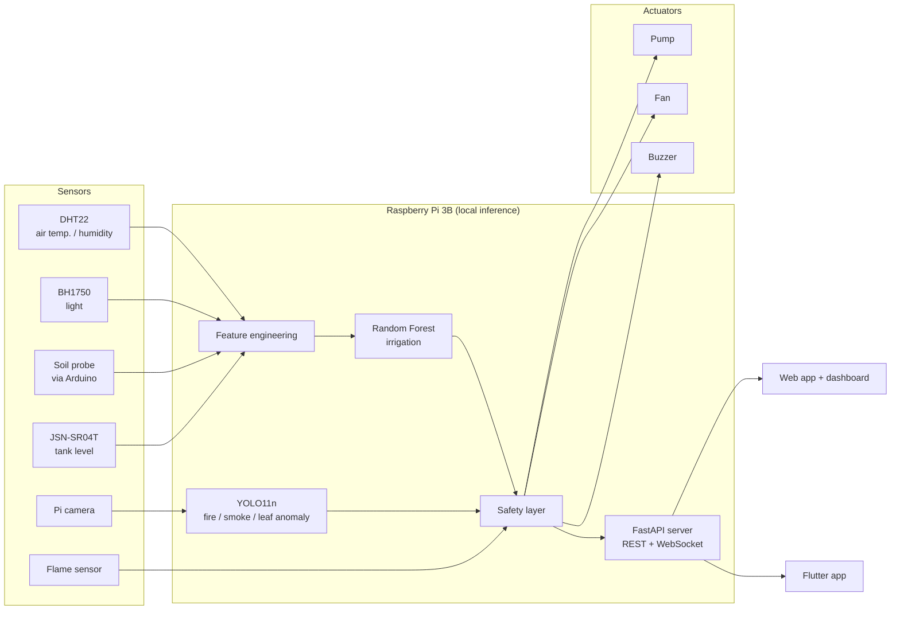

---

## Irrigation model — Random Forest

### Problem formulation

> *"If we do not water now, will the tomato enter water stress within the next 3 hours?"*

This is a binary classification task (`irrigation_needed` ∈ {0, 1}). The label does not mean "the soil is dry". It means "the water left in the pot will not last 3 hours". Predicting it needs both the **reserve** (soil moisture) and the **expected consumption** (light, temperature, air dryness, plant size, time of day).

### Dataset

- `data/smartfarm_tomato_dataset_v4.csv`: **36,288 samples** at 10-minute intervals, two growing cycles, simulated with realistic sensor faults.
- Class balance: 65.3 % "no need" / 34.7 % "needs water".
- Sensor defects modelled and cleaned: missed DHT22 readings, serial glitches on the soil probe (raw ADC values of 0 or 1023), BH1750 saturation.

### Pipeline

1. **Cleaning**: out-of-range soil readings set to `NaN`, then forward-filled within each cycle. The cleaning is causal, so the Pi can reproduce it in real time from past readings only.
2. **Feature engineering**: 10 physically motivated features.

   | Feature | Meaning |
   |---|---|
   | `soil_moisture_pct` | Water reserve in the pot |
   | `air_temp_c`, `air_humidity_pct` | Air conditions |
   | `light_lux`, `light_mean_1h` | Instantaneous and 1-hour mean light (drives transpiration) |
   | `vpd_kpa` | Vapour pressure deficit: how strongly the air pulls water from the leaves |
   | `hour_sin`, `hour_cos` | Time of day encoded on a circle (23:50 and 00:10 are neighbours) |
   | `soil_slope_1h` | Soil moisture change over the last hour (current consumption rate) |
   | `days_after_transplant` | Plant size proxy (leaf area grows ~6× in 6 weeks) |

3. **Train/test split by week**: one ISO week in five is held out (29,208 train / 7,044 test rows). Readings taken 10 minutes apart are nearly identical, so a random split would leak them between train and test.
4. **Hyperparameter search**: `GridSearchCV` with `GroupKFold` (3 folds grouped by week), optimising F1.
   Selected: `n_estimators=100`, `max_depth=12`, `min_samples_leaf=20`, `class_weight="balanced"`.
5. **Decision threshold**: chosen on cross-validated training probabilities to maximise the **F2 score**, which weights recall twice as much as precision. A missed watering costs more than an unnecessary one. Selected threshold: **0.30**.
6. **Export**: model, ordered feature list, threshold and scikit-learn version are saved in a single file, `models/modele_irrigation_tomate.joblib` (≈ 1.2 MB).

### Results (held-out test weeks, never used for tuning)

| Model | Accuracy | Precision | Recall | F1 | Missed waterings (FN) | Unneeded waterings (FP) |
|---|---|---|---|---|---|---|
| Baseline: `soil < 76 %` (best fixed threshold) | 0.934 | 0.968 | 0.851 | 0.906 | 391 | 75 |
| Random Forest, tuned hyperparameters, threshold 0.5 | 0.968 | 0.966 | 0.948 | 0.957 | 136 | 87 |
| **Random Forest, tuned (deployed threshold 0.30)** | **0.962** | **0.916** | **0.988** | **0.950** | **31** | 240 |

ROC AUC **0.996** · Precision-Recall AUC **0.994**.

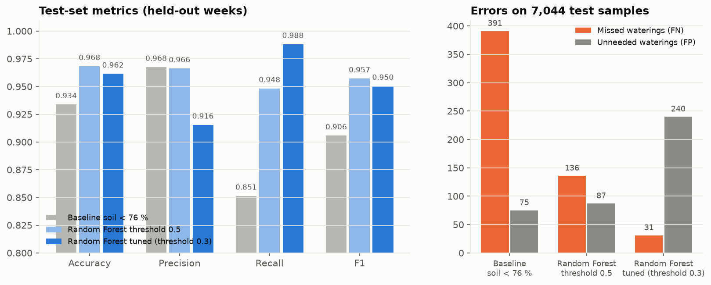

Compared with the best fixed-threshold rule, the deployed model cuts missed waterings by **92 %** (391 → 31) and raises recall from 0.851 to **0.988**. The cost is more unneeded waterings, which the safety layer bounds by capping each pump pulse. A missed watering stresses the plant; an extra short pulse only wastes a little water.

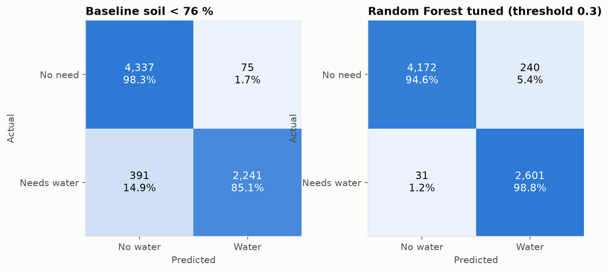

**The model ranks almost perfectly.** The ROC and Precision-Recall curves stay close to the ideal corner, and the baseline rule (orange) sits below the model's curve. At the same false-positive rate, the model finds more of the plants that need water.

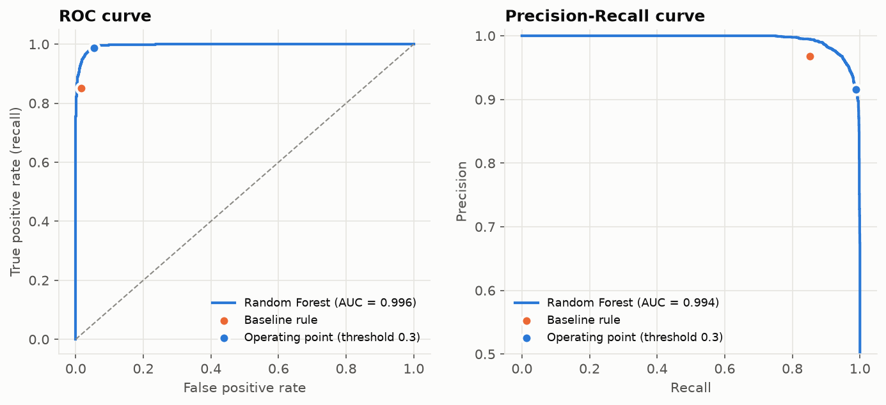

**Threshold selection.** The 0.30 threshold maximises the F2 score on cross-validated *training* weeks, so the test set played no part in choosing it.

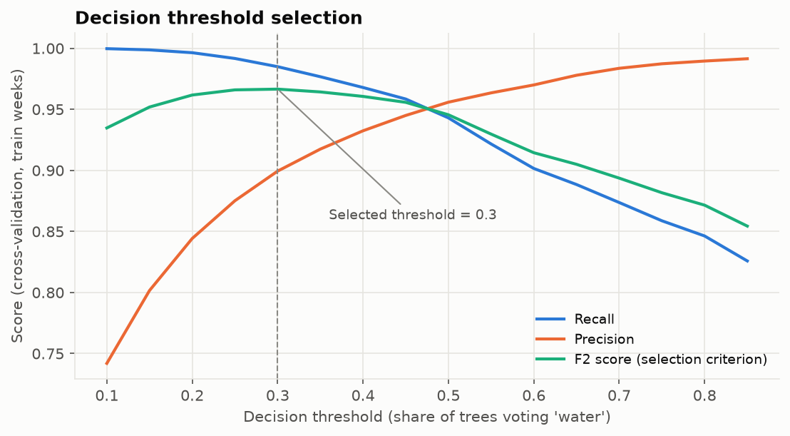

**Where the model makes the difference.** Very dry or very wet soil is easy for both methods. In the ambiguous 65–95 % band, F1 rises from **0.774** (baseline) to **0.896** (Random Forest). Above 85 % the fixed rule never waters at all, while the model still catches the plants that will run dry within 3 hours. It does this by estimating upcoming consumption: at the same 80 % soil moisture, it waters at 11:00 in full sun and does nothing at 23:00.

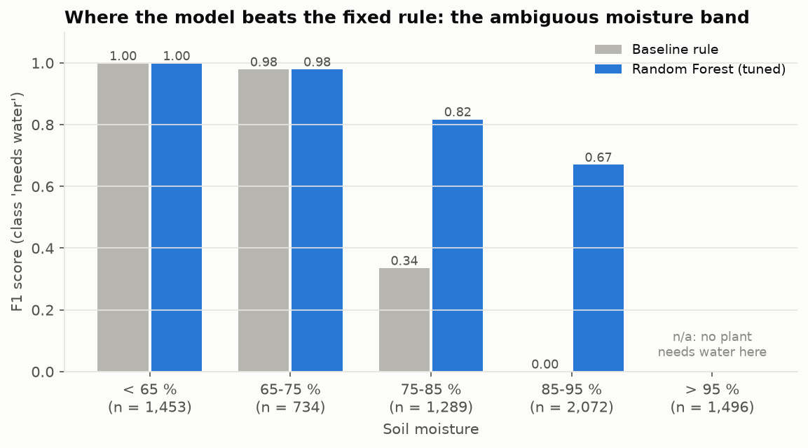

**Feature importance.** Soil moisture (0.81) dominates, followed by days after transplant (0.07), then light, time of day, temperature, humidity, soil slope and VPD. These are the signals that predict how fast the plant will drink.

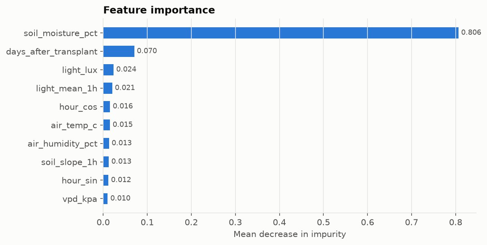

<details>
<summary><b>Exploratory data analysis</b> (from the notebook)</summary>

One week of greenhouse data: soil moisture with the label = 1 periods highlighted, air temperature and humidity, light.

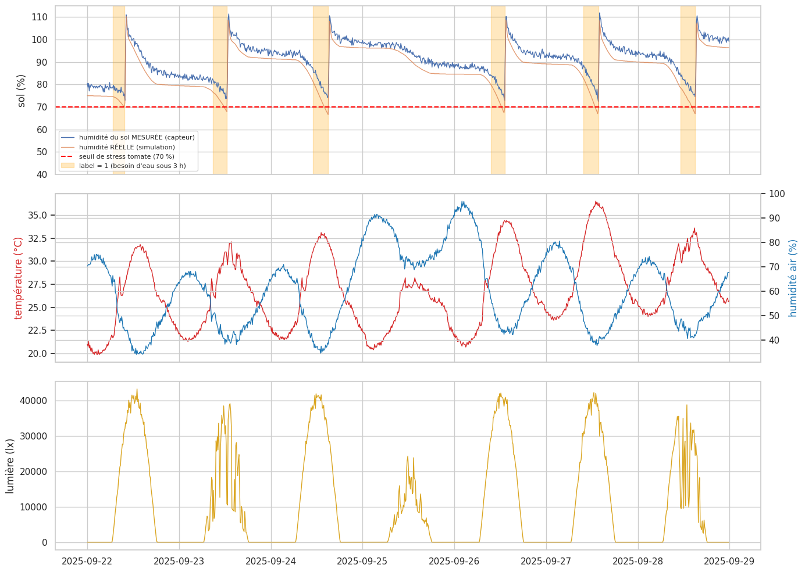

Soil moisture distribution by class: the two classes overlap between ~70 % and ~90 %, so soil moisture alone cannot separate them.

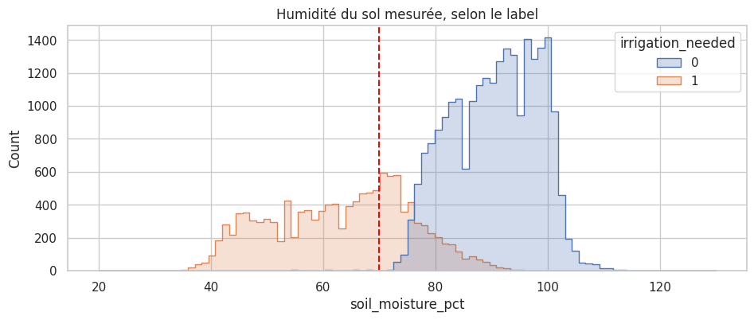

Feature correlations:

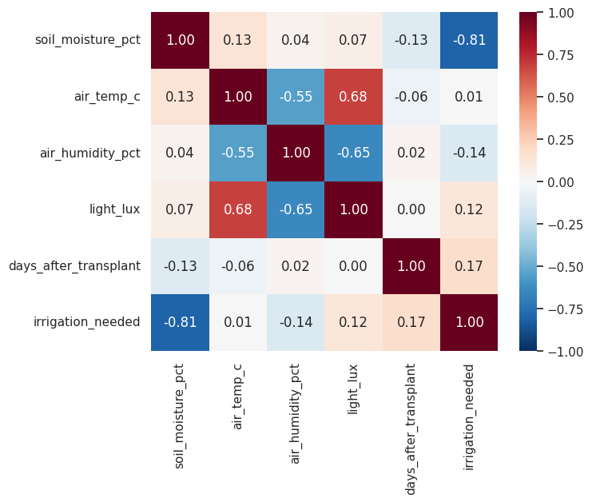

</details>

> These scores measure the model on simulated data. They are not a measure of performance in the physical greenhouse. See [Known limitations](#known-limitations).
> All figures can be regenerated with `python docs/make_figures.py`.

The full, commented analysis (EDA, cleaning, feature engineering, evaluation, feature importance) is in [`notebooks/smartfarm_irrigation_rf.ipynb`](notebooks/smartfarm_irrigation_rf.ipynb).

---

## Visual anomaly detection — YOLO11n

### Approach

A **YOLO11n** detector (~2.6 M parameters, the smallest YOLO11 variant) is **fine-tuned from COCO pre-trained weights** on a labelled dataset built for the greenhouse. With transfer learning, the model starts from generic shape and texture features instead of training from scratch, and the nano size keeps inference fast enough for the Raspberry Pi CPU.

### Labelled dataset

Built by [`vision/prepare_dataset.py`](vision/prepare_dataset.py) from two public, annotated datasets:

| Class | Source | Notes |
|---|---|---|
| `fire` | D-Fire | Bounding boxes, YOLO format |
| `smoke` | D-Fire | Bounding boxes, YOLO format |
| `leaf_healthy` | PlantDoc ("Tomato leaf") | Tomato leaves only |
| `leaf_anomaly` | PlantDoc (all tomato diseases merged) | PlantDoc has only ~200 boxes per tomato disease, too few for separate classes. A single "anomaly" class is more robust, and the greenhouse only needs to know that a leaf needs attention. |

**Class balancing:** D-Fire is subsampled to 8,000 training / 1,500 validation images. The ~500 tomato images are oversampled ×4 in the training list.

### Training

```bash
python vision/download_datasets.py     # fetch D-Fire and PlantDoc into vision/raw/
python vision/prepare_dataset.py       # build the merged YOLO dataset
python vision/train_yolo.py            # fine-tune YOLO11n (60 epochs, early stopping patience 15, cosine LR)
python vision/plot_training.py         # plot mAP and loss curves
```

The script copies the best checkpoint to `vision/models/smartfarm_yolo11n.pt`. It also exports **ONNX** and **NCNN**; NCNN is the fastest format on the Pi.

### Results

| Class | mAP@50 |
|---|---|
| fire | _to fill from `train_yolo.py` output_ |
| smoke | _to fill_ |
| leaf_healthy | _to fill_ |
| leaf_anomaly | _to fill_ |
| **All classes** | _mAP@50 = … · mAP@50-95 = …_ |

<!-- Fine-tuning curves: copy vision/runs/smartfarm_yolo11n/results.csv from the training PC,
     run `python docs/make_figures.py`, then uncomment the line below.

-->

**Detections of the fine-tuned model** on the demo images, using the exported ONNX model and the same per-class thresholds as on the Pi. Rows show fire scenes, diseased tomato leaves, and healthy plants:

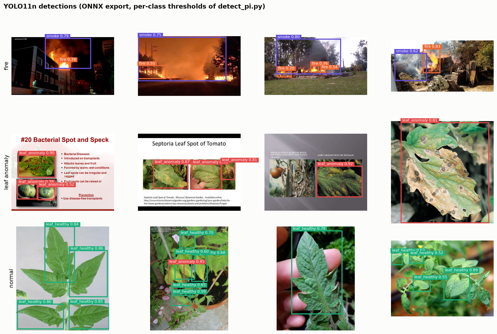

### Inference on the greenhouse

- One frame every **30 s** from the Pi camera ([`app/server/vision.py`](app/server/vision.py), [`vision/detect_pi.py`](vision/detect_pi.py)).
- **Per-class confidence thresholds**: fire 0.35, smoke 0.40, leaf anomaly 0.45, healthy leaf 0.50. Fire is deliberately more sensitive, because a missed fire costs far more than a false alarm.
- **Fire confirmation**: fire or smoke must appear in **2 consecutive frames** before the alarm triggers, to filter out single-frame false positives.
- In simulation mode, the real model runs on sample photos from `app/server/demo_images/` (`normal`, `leaf_anomaly`, `fire`), so you can demo the detector without a camera.

---

## Safety layer

Hard-coded rules sit **above** both models and always take precedence:

| Condition | Action |
|---|---|
| Flame detected (sensor or confirmed vision) | Buzzer on; pump **and** fan cut (the fan would feed the fire) |
| Missing sensor reading | Pump cut, decision cycle skipped |
| Tank empty | Pump forbidden, refill alert |
| 2 failed waterings in a row (leak / stuck pump) | Pump locked until a person unlocks it from the app |
| Every watering | Short pulse stopped by a hardware timer (never longer than 10 s), then 60 s for the water to spread |

---

## Applications

The interface follows the *SmartFarm Interface v2* design. Accounts are stored locally on the Pi, and creating one requires the greenhouse code.

| Screen | Purpose |
|---|---|
| **Greenhouse** | Overall status in one sentence, plus soil, tank, air and light, safety, and plant health |
| **Watering** | Tank level and autonomy, last watering, manual watering with step-by-step tracking (sent → received → running → checked) |
| **Ventilation** | Fan state, today's runs, manual control; automatic mode resumes after 1 hour |
| **Log** | Timeline of decisions, each with a **Why?** explanation |
| **Alerts / Settings** | Alerts, notification and threshold settings, pump unlock, account |
| **Dashboard** (PC) | Live 3D greenhouse (three.js), statistics, model explanations, simulation lab |

- **Web app**: served by the Pi on port 8000. No build step, and it works without internet.
- **Flutter app** (`mobile/`): Android, can also run in a browser for testing. It talks only to the Pi.
- **NestJS backend** (`application/backend/`): bridge between the Flutter app and the edge API.

---

## Repository structure

| Path | Contents |
|---|---|
| `data/` | Irrigation dataset (`smartfarm_tomato_dataset_v4.csv`) |
| `notebooks/` | Irrigation Random Forest analysis notebook |
| `train.py` / `predict.py` | Random Forest training pipeline / inference and safety helpers |
| `models/` | Trained irrigation model (`.joblib`) |
| `vision/` | YOLO dataset preparation, training, plotting, Pi detector, trained weights (`.pt`, `.onnx`) |
| `app/server/` | FastAPI farm server: controller, accounts (SQLite), simulator, statistics, vision, REST + WebSocket API |
| `app/web/` | Web app and dashboard (three.js vendored, fonts bundled) |
| `edge_ai/` | Pi runtime: hardware drivers, wiring and calibration config, stand-alone CLI agent |
| `mobile/`, `application/` | Flutter app and NestJS backend |
| `deploy/` | Raspberry Pi install script, systemd service, Pi requirements |
| `tests/` | Automated tests for the agent and the app |
| `docs/` | Technical dossier (GPIO table, wiring, Arduino bridge, 3D-printed enclosure), screenshots, README figures (`figures/`, regenerated by `make_figures.py`) |

---

## Quick start (simulation, no hardware)

**Requirements:** Python 3.10+ on Windows.

```bash
python -m venv .venv
.venv\Scripts\pip install fastapi uvicorn[standard]     # app only
.venv\Scripts\pip install -r requirements.txt           # full stack: ML training + vision
```

1. Double-click **`start_app.bat`**. It starts the farm in simulation and opens <http://localhost:8000>.
2. Choose **Connect my greenhouse** and create an account. In simulation, the greenhouse code is **`123456`**.
3. On a PC, the dashboard opens on the right. In the **Simulation lab** you can speed up time, dry the soil, light a flame, or inject a leak, a stuck pump or a faulty probe, then watch how the system reacts.

`start_app_phone.bat` does the same but listens on the Wi-Fi, so a phone on the same network can reach it.

### Flutter app

```bash
cd mobile
flutter pub get
flutter run                      # phone connected by USB (or: flutter run -d chrome)
flutter build apk --release      # → mobile/build/app/outputs/flutter-apk/app-release.apk
```

At first launch, enter the greenhouse address: the Pi's IP on the Wi-Fi (e.g. `192.168.1.20`), or `10.0.2.2` from the Android emulator to reach the PC.

---

## Reproducing the models

```bash
# Irrigation Random Forest → models/modele_irrigation_tomate.joblib
python train.py
python predict.py        # demo: same soil moisture, different decision at 11:00 vs 23:00

# Vision YOLO11n → vision/models/
python vision/download_datasets.py
python vision/prepare_dataset.py
python vision/train_yolo.py              # add --device cpu without an NVIDIA GPU
```

For an NVIDIA RTX 50xx GPU, install PyTorch from the CUDA 12.8 index **before** `ultralytics`:
`pip install torch torchvision --index-url https://download.pytorch.org/whl/cu128`

The committed irrigation model was trained with **scikit-learn 1.6.1** (pinned in `requirements.txt`). Load it with the same version.

---

## Deployment on the Raspberry Pi 3B

1. Copy the repository to the Pi (Raspberry Pi OS), without the Windows `.venv` folder:
   `scp -r cas-2026 pi@<pi-ip>:~/`
2. Install the virtual environment, Pi libraries, I2C and the systemd service:
   ```bash
   cd ~/cas-2026 && bash deploy/install_pi.sh 2026-11-01      # tomato transplant date
   ```
3. **Test the wiring** before letting the agent drive the pump:
   ```bash
   cd edge_ai/edge && ../../venv/bin/python runtime.py --selftest
   ```
   The self-test clicks each relay and the buzzer, checks the flame sensor (hold a lighter near it), and prints the raw ultrasonic distance. Adjust [`edge_ai/edge/config.py`](edge_ai/edge/config.py) if needed:
   - `RELAY_ACTIVE_LOW`: flip it if a relay is ON at rest.
   - `FLAME_ACTIVE_LOW`: flip it if the flame is detected on the wrong level.
   - `SENSOR_DIST_FULL_CM` / `SENSOR_DIST_EMPTY_CM`: distances measured with the tank full and empty.
   - `SOIL_RAW_WET` / `SOIL_RAW_DRY`: raw soil-probe readings in wet and dry soil.
4. Start the service: `sudo systemctl start smartfarm`. Follow the logs with `journalctl -u smartfarm -f`.
5. Read the greenhouse code with `cat app/server/data/greenhouse_code.txt` (it is also printed in the logs) and label it on the greenhouse.
6. Open `http://<pi-ip>:8000` from any device on the same Wi-Fi, or enter the Pi's address in the Flutter app.
7. **Camera**: vision is disabled by default on the Pi 3B. Enable it with `SMARTFARM_VISION=1`, preferably with the NCNN export.

The agent saves its history every 5 minutes to `app/server/data/state_real.json`, so a pump lock survives a reboot.

### Hardware notes

- **JSN-SR04T blind zone**: the sensor cannot measure closer than ~20–25 cm. Mount it at least 25 cm above the "full" water line and enter the measured distances in `config.py`.
- **Arduino bridge**: the Pi expects the sketch from the technical dossier (`Serial.println(analogRead(A0))` every 500 ms, 9600 baud) on `/dev/ttyACM0`.
- **Calibrate on the prototype**: measure how much one pump pulse changes the soil reading and the tank level. If your values differ from the simulation, retrain.

---

## Testing

```bash
.venv\Scripts\python -m unittest discover -s tests -v
```

The tests cover the safety rules, watering fault diagnosis (leak / stuck pump / faulty probe), the pump lock, the empty-tank rule, state persistence, statistics, and the consistency between the explanations shown in the app and the code that runs on the Pi.

---

## Known limitations

- **Simulated training data.** The irrigation model is trained on simulated data based on tomato agronomy, not on readings from this greenhouse. Log real readings on the prototype and retrain.
- **Public image datasets.** The vision model is trained on D-Fire and PlantDoc images, not on photos of this greenhouse. Expect some domain shift (lighting, camera angle, plant stage). Fine-tune on greenhouse photos when available.
- **Pi 3B memory.** 1 GB of RAM is tight for running the YOLO detector next to the agent. Use the NCNN export, or a Pi 4/5 for continuous camera monitoring.
- **Single soil probe** shared by two pots: both plants are reported with the same soil moisture.
- **Local, simple accounts.** Anyone with the greenhouse code can create an account, and every account can water and ventilate. Traffic uses plain HTTP on the local Wi-Fi.
- **No SMS gateway.** The flame alarm sounds on site and appears in the app; the emergency contact in Settings is a call button.

---

## Credits and licences

- **D-Fire**: de Venâncio et al., <https://github.com/gaiasd/DFireDataset>. Check its licence before redistributing.
- **PlantDoc**: Singh et al., CC BY 4.0, <https://github.com/pratikkayal/PlantDoc-Object-Detection-Dataset>.
- **YOLO11**: Ultralytics, <https://github.com/ultralytics/ultralytics> (AGPL-3.0).
- **three.js** (MIT), vendored in `app/web/vendor/three/`.
